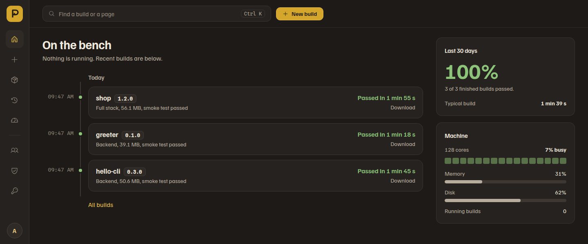

# Packwright

[](LICENSE)
[](https://github.com/xianhong1208/packwright/actions/workflows/ci.yml)
[](https://github.com/xianhong1208/packwright/releases/latest)

**A self-hosted build server that turns a Python backend and its web frontend into one standalone
program, or a Docker image, from a web console.**

[Quick start (zh-TW)](docs/quickstart.zh-TW.md) · [Manual (zh-TW)](docs/manual.zh-TW.md) ·
[繁體中文](README.zh-TW.md) · [Roadmap](ROADMAP.md) · [Changelog](CHANGELOG.md)

Point Packwright at a folder on the server or a Git URL. It compiles Python to a standalone executable
with [Nuitka](https://nuitka.net/), builds the frontend with npm, yarn, pnpm or bun, packages the two
together and can export the result as a Docker image `.tar.gz`, with live build logs, projects and
versions, accounts and role-based permissions.



## What's new

**1.3.1** (2026-11-09) fixes what a full review found: a role change can no longer lock everyone out, a
local build's download is that build's output only, the entry point must be inside the project, git
never uses the server's own git login, and browsing no longer hits the rate limit. 1.3.0 stopped builds
from seeing the service's secrets. See [CHANGELOG.md](CHANGELOG.md), and [ROADMAP.md](ROADMAP.md) for
what comes next.

## Key features

- **Four build modes.** Backend only (Nuitka), frontend only (any Node package manager), full stack
  (the frontend bundled into the Nuitka build as data), and Docker output (the build packaged into an
  image and exported as `.tar.gz`). Images carry only the system libraries the program's extensions
  load, onefile binaries are compressed, the program runs as a non-root user, and its state folders
  (found by the smoke test) are declared as volumes, with a suggested `docker run` that keeps them. The
  smoke test warns when the program listens on another port than the image exposes.
- **Quick build.** Give it a folder or a Git URL and it reads the project: backend, frontend or full
  stack, the entry point, where `package.json` is, the Python version and dependency groups. One click
  starts the build; every setting is still there under *All settings*.
- **Projects and versions.** Every build is filed under a project (the same name and source). A
  project's page lists its versions and builds a new one in one dialog; the version is read from the Git
  tag, `pyproject.toml` or `package.json`, names the download, tags the Docker image and is written into
  a `VERSION` file. Projects are shared by everyone who may build.
- **Local path or Git URL sources.** Git mode clones the repository, bootstraps a `.venv` with
  `uv sync`, builds, and cleans the workspace afterwards. URLs are validated against SSRF, subprocesses
  get argument lists only, and each clone has a time limit.
- **Git credentials managed in the console.** GitHub, GitLab and self-hosted tokens are stored
  encrypted and chosen by the clone URL's host; no secrets in `.env`.
- **Live logs and history.** Every build streams over WebSocket; a finished build keeps the exact
  settings that produced it, so a rebuild does the same thing.
- **Notifications.** A project can send how its builds end to Discord, Slack or any URL that takes JSON:
  failed builds with the diagnosis, passed ones with how long they took.
- **Faster rebuilds.** With [ccache](https://ccache.dev/) installed, Nuitka reuses the C files that did
  not change, and builds running together share the machine's cores.
- **Accounts, roles, permissions.** JWT sessions with refresh-token rotation, roles and permissions,
  login history and an audit log. The first start creates the administrator.
- **Built to run unattended.** Background sweeps reclaim workspace and exported-image disk space on a
  schedule, and a systemd unit or Docker keeps the service up.

## Installation

### With Docker

The image carries everything builds need: the Nuitka toolchain for Python 3.12 to 3.14, ccache,
Node.js (npm, yarn and pnpm through corepack), git and the docker CLI.

```bash
git clone https://github.com/xianhong1208/packwright.git
cd packwright
docker compose up -d
docker compose logs packwright | grep "bootstrap admin"   # the first sign-in password
```

Everything Packwright keeps (database, generated secrets, workspaces, outputs, the compile cache) is in
the `packwright-data` volume, so `docker compose up -d --build` after a `git pull` upgrades without
losing anything. Builds run as uid 1000 inside the container. `docker-compose.yml` shows how to let
builds read folders on the host and, if you trust every account, use the host's Docker for Docker
output.

### From source

**Prerequisites:** Python 3.13+, [uv](https://docs.astral.sh/uv/), Node.js 22.12+ (to build the console,
and for frontend builds), a C compiler for Nuitka, and Docker for Docker output. The database is a local
SQLite file by default; PostgreSQL is optional (set `DATABASE_URL`). `pigz` is optional and speeds up
image compression. ccache is optional and strongly recommended: a rebuild can be several times faster
(the **Machine** page says whether it is on).

```bash
git clone https://github.com/xianhong1208/packwright.git
cd packwright
uv sync                       # backend dependencies
cd frontend && npm install && npm run build && cd ..
cp .env.example .env          # optional; SQLite works with no configuration
```

## Quick start

```bash
uv run python main.py         # applies migrations, then serves on http://0.0.0.0:5018
```

1. Open `http://localhost:5018` and sign in as **`admin`** with the password printed in the startup
   log (`Created bootstrap admin 'admin' with generated password: …`). It is generated on first start
   and shown only once: change it after signing in, or set `BOOTSTRAP_ADMIN_USERNAME` /
   `BOOTSTRAP_ADMIN_PASSWORD` before the first start.
2. To build from a folder on the server, set `LOCAL_SOURCE_ROOTS` to the folders builds may read (empty
   disables local builds). For private repositories, add a token under **Git credentials** in the left
   rail (GitHub, GitLab or a self-hosted server).
3. Choose **New build**, give it the folder or the Git URL, check what Quick build found, and press
   **Start build**. The log streams live; the finished program is downloadable from the build's page, or
   exported as a Docker image `.tar.gz`.

A step-by-step walkthrough, in Traditional Chinese, is in
[docs/quickstart.zh-TW.md](docs/quickstart.zh-TW.md).

## Deployment options

- **Docker Compose** (above): one container with every build tool, data in a volume.
- **A system service:** `deploy/packwright.service` is an example systemd unit; adjust its
  `WorkingDirectory`, `ExecStart` and `PATH`, then `systemctl enable --now packwright`.
- **Behind a reverse proxy:** put HTTPS in front, forward WebSockets (`/ws/`) so logs stream live, and
  set `TRUSTED_PROXY_IPS` to the proxy's address.
- **One worker only.** Task state, WebSocket connections and build slots live in the process, so run a
  single uvicorn worker; `MAX_CONCURRENT_BUILDS` (default 3) bounds builds at once and the rest queue.

Every setting is an environment variable and none is required: the ones most installs touch and where
the data lives are in [How Packwright works](docs/how-it-works.md); every setting with its default is
in [docs/configuration.md](docs/configuration.md).

**Security.** Packwright runs build commands from the projects it builds, so anyone who may start a
build can run code as the service's user: approving accounts is the real security boundary. URL
validation, path confinement, a filtered build environment and rate limits are defence in depth, not a
sandbox. Run it on an isolated host behind HTTPS, and keep `TRUSTED_PROXY_IPS` empty unless a proxy
really rewrites `X-Forwarded-For`. [SECURITY.md](SECURITY.md) has the trust model, the known
limitations and how to report a vulnerability.

## Documentation

| | |
|---|---|
| [Quick start (zh-TW)](docs/quickstart.zh-TW.md) | the first build in five minutes |
| [Manual (zh-TW)](docs/manual.zh-TW.md) | every page and flow of the console, deployment, troubleshooting |
| [How Packwright works](docs/how-it-works.md) | what happens to a build, the main settings, where data lives, Git credentials |
| [Configuration reference](docs/configuration.md) | every setting with its default |
| [SECURITY.md](SECURITY.md) | trust model, known limitations, reporting a vulnerability |
| [ROADMAP.md](ROADMAP.md) | what is shipped and what comes next |

## Contributing

Setup, the checks CI runs, branch and commit conventions and the release steps are in
[CONTRIBUTING.md](CONTRIBUTING.md). Changes are listed in [CHANGELOG.md](CHANGELOG.md).

## Licence

[MIT](LICENSE)
