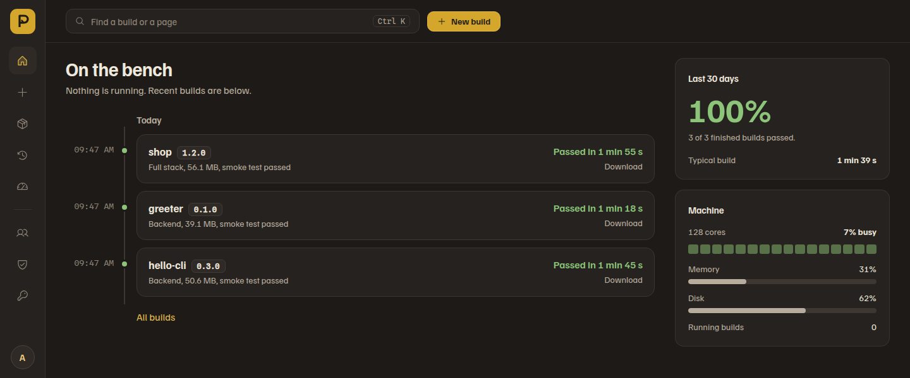

# Packwright

[](LICENSE)
[](https://github.com/xianhong1208/packwright/actions/workflows/ci.yml)
[](https://github.com/xianhong1208/packwright/releases/latest)

**自架的建置伺服器：在網頁管理台裡，把 Python 後端和它的網頁前端打包成一個獨立執行的程式，或一個 Docker image。**

[5 分鐘上手](docs/quickstart.zh-TW.md) · [操作手冊](docs/manual.zh-TW.md) · [English](README.md) ·
[發展路線圖](ROADMAP.zh-TW.md) · [變更紀錄](CHANGELOG.md)

指定伺服器上的一個資料夾或一個 Git URL，Packwright 就用 [Nuitka](https://nuitka.net/) 把 Python 編成獨立執行檔、用 npm、yarn、
pnpm 或 bun 建置前端、把兩者打包在一起，還能把結果匯出成 Docker image `.tar.gz`；建置日誌即時顯示，並有專案與版本、帳號與角色權限。



## 最新消息

**1.3.1**（2026-11-09）修正全面檢查後找到的問題：變更角色不會再讓所有人都被鎖在外面，本機建置下載到的只會是那一次的產出，進入點
必須在專案裡，git 不會用到伺服器自己的 git 登入，一般瀏覽也不會再撞到速率限制。1.3.0 讓建置看不到服務本身的密鑰。詳見
[CHANGELOG.md](CHANGELOG.md)，接下來的計畫見 [ROADMAP.zh-TW.md](ROADMAP.zh-TW.md)。

## 主要功能

- **四種打包模式。** 純後端（Nuitka）、純前端（任一 Node 套件管理器）、全端（前端產出作為 data 一起編進 Nuitka），以及 Docker
  輸出（打包成 image 並匯出 `.tar.gz`）。
- **快速建置。** 指定資料夾或 Git URL，系統會自己讀出專案內容：後端、前端還是全端、進入點、`package.json` 在哪、Python 版本與依賴
  群組。按一下就開始建置；所有設定仍可在 *All settings* 調整。
- **專案與版本。** 每次建置都歸到一個專案（同名稱、同來源）。專案頁列出所有版本，一個對話框就能建置新版本；版本從 Git tag、
  `pyproject.toml` 或 `package.json` 讀出，用在下載檔名、Docker image 的 tag，並寫進 `VERSION` 檔。專案由所有有建置權限的人共用。
- **本機路徑或 Git URL 來源。** Git 模式會 clone repo、用 `uv sync` 建立 `.venv`、打包，完成後清理工作區。URL 驗證做了 SSRF 防護、
  subprocess 一律用參數列表，每次 clone 都有逾時上限。
- **Git 憑證在管理台設定。** GitHub、GitLab 與自架服務的 token 加密儲存，依 clone URL 的主機自動選用；`.env` 裡不放任何密鑰。
- **即時日誌與歷史。** 每個建置都透過 WebSocket 串流；完成的建置保留當時完整的設定，重新打包會做一模一樣的事。
- **通知。** 專案可以把建置結果送到 Discord、Slack 或任何接收 JSON 的網址：失敗的附上診斷，成功的附上花了多久。
- **重建更快。** 裝了 [ccache](https://ccache.dev/)，Nuitka 會重用沒變的 C 檔；同時進行的建置會分攤機器的核心。
- **帳號、角色、權限。** JWT session 與 refresh token 輪替、角色與權限、登入歷史與稽核日誌。首次啟動時建立管理員。
- **可長期無人值守。** 背景排程定期回收工作區與匯出 image 的磁碟空間，systemd unit 或 Docker 讓服務保持常駐。

## 安裝

### 用 Docker

image 裡已經有建置需要的一切：Python 3.12 到 3.14 的 Nuitka 工具鏈、ccache、Node.js（npm，yarn 與 pnpm 透過 corepack）、git 與
docker CLI。

```bash
git clone https://github.com/xianhong1208/packwright.git
cd packwright
docker compose up -d
docker compose logs packwright | grep "bootstrap admin"   # 第一次登入的密碼
```

Packwright 保存的一切（資料庫、自動產生的金鑰、工作區、產出、編譯快取）都在 `packwright-data` volume 裡，所以 `git pull` 後
`docker compose up -d --build` 就能升級，不會遺失資料。建置在容器裡以 uid 1000 執行。`docker-compose.yml` 裡有說明怎麼讓建置讀取
主機上的資料夾，以及（在信任所有帳號時）讓 Docker 輸出使用主機的 Docker。

### 從原始碼

**環境需求：** Python 3.13+、[uv](https://docs.astral.sh/uv/)、Node.js 22.12+（建置管理台與前端建置用）、Nuitka 需要的 C 編譯器，
以及 Docker（Docker 輸出用）。資料庫預設是本機 SQLite 檔；PostgreSQL 為選用（設 `DATABASE_URL`）。`pigz` 選用，可加速 image 壓縮。
ccache 選用但強烈建議：重建可以快好幾倍（**Machine** 頁會顯示有沒有啟用）。

```bash
git clone https://github.com/xianhong1208/packwright.git
cd packwright
uv sync                       # 後端相依
cd frontend && npm install && npm run build && cd ..
cp .env.example .env          # 選用;用 SQLite 完全免設定
```

## 快速開始

```bash
uv run python main.py         # 先套用 migration,再於 http://0.0.0.0:5018 提供服務
```

1. 開啟 `http://localhost:5018`，以 **`admin`** 登入，密碼在啟動 log 裡（`Created bootstrap admin 'admin' with generated
   password: …`）。密碼於首次啟動時隨機產生且只顯示一次：登入後請改密碼，或在首次啟動前設定 `BOOTSTRAP_ADMIN_USERNAME` /
   `BOOTSTRAP_ADMIN_PASSWORD`。
2. 要從伺服器上的資料夾建置，把 `LOCAL_SOURCE_ROOTS` 設成建置可以讀取的資料夾（留空則停用本機建置）。私有 repo 請在左側工具列的
   **Git credentials** 加入 token（GitHub、GitLab 或自架伺服器）。
3. 選 **New build**，給它資料夾或 Git URL，看一下快速建置讀出的內容，按 **Start build**。日誌即時串流；完成的程式可以在建置頁面
   下載，或匯出成 Docker image `.tar.gz`。

逐步操作教學見 [docs/quickstart.zh-TW.md](docs/quickstart.zh-TW.md)。

## 部署方式

- **Docker Compose**（見上方）：一個容器裝好所有建置工具，資料放在 volume。
- **系統服務：** `deploy/packwright.service` 是範例 systemd unit，調整其中的 `WorkingDirectory`、`ExecStart` 與 `PATH` 後執行
  `systemctl enable --now packwright`。
- **放在反向代理後面：** 前面放 HTTPS，轉送 WebSocket（`/ws/`）讓日誌即時更新，並把 `TRUSTED_PROXY_IPS` 設成代理的位址。
- **只能有一個 worker。** 任務狀態、WebSocket 連線與建置名額都在行程記憶體裡，所以只跑一個 uvicorn worker；`MAX_CONCURRENT_BUILDS`
  （預設 3）限制同時進行的建置數，其餘排隊。

所有設定都是環境變數，沒有任何必填項：大多數安裝會用到的設定與資料放在哪裡，見[運作方式](docs/how-it-works.zh-TW.md)；所有設定與
預設值見 [docs/configuration.md](docs/configuration.md)（英文）。

**安全性。** Packwright 會執行它所建置專案裡的建置指令，所以任何能啟動建置的人，都能以服務使用者的身分執行程式碼：**帳號核准才是
真正的安全邊界**。URL 驗證、路徑限制、過濾過的建置環境與速率限制是縱深防禦，不是沙箱。請跑在隔離的主機上、前面掛 HTTPS，除非真的
有代理改寫 `X-Forwarded-For`，否則 `TRUSTED_PROXY_IPS` 保持空白。信任模型、已知限制與回報漏洞的方式見 [SECURITY.md](SECURITY.md)。

## 文件

| | |
|---|---|
| [5 分鐘上手](docs/quickstart.zh-TW.md) | 五分鐘完成第一次建置 |
| [操作手冊](docs/manual.zh-TW.md) | 管理台的每個頁面與流程、部署、疑難排解 |
| [運作方式](docs/how-it-works.zh-TW.md) | 建置經過哪些步驟、主要設定、資料放在哪裡、Git 憑證 |
| [設定參考](docs/configuration.md)（英文） | 所有設定與預設值 |
| [SECURITY.md](SECURITY.md)（英文） | 信任模型、已知限制、回報漏洞 |
| [發展路線圖](ROADMAP.zh-TW.md) | 已發布與接下來的內容 |

## 參與開發

環境設定、CI 會跑的檢查、分支與 commit 慣例、發布步驟見 [CONTRIBUTING.md](CONTRIBUTING.md)。變更紀錄見
[CHANGELOG.md](CHANGELOG.md)。

## 授權

[MIT](LICENSE)
